<p align="center">
   Bonjour, je suis NjGuitlab — Développeur logiciel | Backend | API REST | QA & Automatisation" />
</p>

<p align="center">
  <b>Développeur logiciel</b> &nbsp;·&nbsp; Backend &nbsp;·&nbsp; API REST &nbsp;·&nbsp; QA &amp; Automatisation<br/>
  <sub>Étudiant en AEC Développement logiciel · Collège de Maisonneuve · Montréal</sub>
</p>

<br/>

## `about.md` &nbsp;À propos

Étudiant en développement logiciel, je viens de l'**assurance qualité logicielle**. Ce double parcours guide ma façon de travailler : je conçois des applications et des **API REST**, je modélise des **bases de données relationnelles**, et j'intègre les **tests** dès le départ plutôt qu'à la fin.

- **Backend** : API REST en TypeScript (Express, Prisma, PostgreSQL, JWT) et applications Java (JDBC, architecture DAO et MVC)
- **Qualité** : automatisation de tests UI et BDD (Selenium, Cucumber, Playwright) et tests unitaires (JUnit)
- **Équipe** : branches de fonctionnalité, pull requests, issues, User Stories et sprints Scrum
- **Prochaine étape** : approfondir **Spring Boot** pour le développement backend en Java

<br/>

## `skills.json` &nbsp;Compétences techniques

<p>
  <b>Langages</b><br/>
  
  
  
  
  
</p>

<p>
  <b>Backend et API</b><br/>
  
  
  
  
  <br/><sub>Architecture MVC · Architecture DAO · Programmation orientée objet</sub>
</p>

<p>
  <b>Frontend et interfaces</b><br/>
  
  
  
  
</p>

<p>
  <b>Bases de données</b><br/>
  
  
  
</p>

<p>
  <b>Tests et QA</b><br/>
  
  
  
  
  <br/><sub>Tests UI · Tests d'API · BDD · Page Object Model · Cypress (notions, projet privé)</sub>
</p>

<p>
  <b>Outils et collaboration</b><br/>
  
  
  
  
  
  <br/><sub>Agile / Scrum · Pull Requests · Issues · GitHub Projects</sub>
</p>

<p>
  <b>En apprentissage</b><br/>
  
</p>

<br/>

## `projects/` &nbsp;Projets phares

<table width="100%">
  <tr>
    <td>
      <h3><a href="https://github.com/NjGuitlab/employee-management-system">employee-management-system</a></h3>
      <sub><b>PROJET INDIVIDUEL</b> &nbsp;·&nbsp; API REST</sub>
      <p>API de gestion des ressources humaines : employés, départements, postes, congés et évaluations, avec authentification par JWT et contrôle d'accès selon le rôle (Admin / Employé).</p>
      <p>
        <code>TypeScript</code> <code>Node.js</code> <code>Express</code> <code>Prisma</code> <code>PostgreSQL</code> <code>JWT</code> <code>bcrypt</code>
      </p>
      <p><b>Réalisé</b> : modèle de données Prisma et migrations, routes CRUD protégées par un middleware JWT, tableau de bord statistique, import de profils depuis une API externe (RandomUser). Le frontend React ne contient pour l'instant que la page de connexion.<br/>
      <b>En cours</b> : renforcement de l'attribution des rôles à l'inscription et ajout de tests automatisés.</p>
    </td>
  </tr>
</table>

<table width="100%">
  <tr>
    <td>
      <h3><a href="https://github.com/NjGuitlab/voitures-occasion-javafx">voitures-occasion-javafx</a></h3>
      <sub><b>PROJET D'ÉQUIPE</b> (3 personnes) &nbsp;·&nbsp; Application de bureau</sub>
      <p>Application de recherche et de gestion d'annonces de voitures d'occasion : recherche en temps réel, filtres multicritères, pagination, favoris, CRUD et comparaison de trois algorithmes de tri.</p>
      <p>
        <code>Java 21</code> <code>JavaFX</code> <code>PostgreSQL</code> <code>JDBC</code> <code>Maven</code> <code>JUnit</code> <code>MVC</code> <code>DAO</code>
      </p>
      <p><b>Ma contribution</b> : modèle <code>Voiture</code> et énumérations ; filtres, pagination, recherche par identifiant, prix par kilomètre et filtrage multicritère ; gestion des favoris ; interface DAO, implémentation PostgreSQL et ses tests JUnit ; connexion à la base, abstraction <code>SourceDonnees</code> et CRUD du DAO.</p>
    </td>
  </tr>
</table>

<table width="100%">
  <tr>
    <td>
      <h3><a href="https://github.com/CoursServicesWeb/planificateur-voyages">planificateur-voyages</a></h3>
      <sub><b>PROJET D'ÉQUIPE</b> (3 personnes) &nbsp;·&nbsp; Application full-stack</sub>
      <p>Application de planification de voyages : destinations, voyages en plusieurs étapes, avis des voyageurs avec note moyenne, authentification et espace d'administration.</p>
      <p>
        <code>TypeScript</code> <code>React</code> <code>Node.js</code> <code>Express</code> <code>Prisma</code> <code>PostgreSQL</code> <code>Axios</code>
      </p>
      <p><b>Ma contribution</b> : routeurs REST, contrôleur des avis, client Axios pour l'API météo, tests de vérification des avis et de la note moyenne ; côté frontend : initialisation du projet React, types partagés, authentification, pages de connexion, d'inscription et d'avis, accueil et en-tête, organisation des composants et configuration Vercel.</p>
    </td>
  </tr>
</table>

<table width="100%">
  <tr>
    <td>
      <h3><a href="https://github.com/jfl24/mind_harbor">mind_harbor</a></h3>
      <sub><b>PROJET D'ÉQUIPE</b> (3 personnes) &nbsp;·&nbsp; Application full-stack</sub>
      <p>Plateforme web de bien-être et de soutien entre utilisateurs, avec journal personnel, groupes de soutien, publications et messagerie privée.</p>
      <p>
        <code>TypeScript</code> <code>React</code> <code>Node.js</code> <code>Express</code> <code>Prisma</code> <code>PostgreSQL</code>
      </p>
      <p><b>Ma contribution</b> : gestion des groupes, des publications et des commentaires, endpoints de messagerie, route des ressources et adaptation de l'architecture backend ; côté frontend : API d'authentification, configuration Axios, types partagés, pages de connexion, d'utilisateur et de groupes.</p>
    </td>
  </tr>
</table>

<table width="100%">
  <tr>
    <td>
      <h3><a href="https://github.com/NjGuitlab/ProjetSeleniumBDD">ProjetSeleniumBDD</a></h3>
      <sub><b>PROJET DE FORMATION QA</b> (2024) &nbsp;·&nbsp; Automatisation de tests</sub>
      <p>Suite de tests automatisés BDD sur l'application de démonstration OrangeHRM : authentification, ajout et suppression d'utilisateurs, déconnexion et recherche selon plusieurs critères.</p>
      <p>
        <code>Java</code> <code>Selenium WebDriver</code> <code>Cucumber</code> <code>JUnit</code> <code>Maven</code> <code>Extent Reports</code>
      </p>
      <p><b>Points clés</b> : scénarios Gherkin, Page Object Model, gestion de plusieurs navigateurs et génération de rapports de tests.<br/>
      <b>État actuel</b> : projet de formation réalisé en 2024, basé sur une ancienne version de Selenium. Une mise à jour technique reste à effectuer.</p>
    </td>
  </tr>
</table>

<br/>

## `wip/` &nbsp;Projets en cours et expériences d'équipe

<table width="100%">
  <tr>
    <td>
      <h3>FishLog</h3>
      <sub><b>ÉQUIPE SCRUM</b> (4 personnes) &nbsp;·&nbsp; Mobile &nbsp;·&nbsp; 🔒 Dépôt privé</sub>
      <p>Application mobile de suivi des journées de pêche.</p>
      <p><code>Flutter</code> <code>Dart</code> <code>MVVM</code></p>
      <p><b>Ma contribution</b> : squelette MVVM et thème, modèles <code>Prise</code> et <code>JourneePeche</code>, contrat <code>JourneeRepository</code> et repository de données fictives, navigation et historique, test UI de l'écran Historique selon les critères de la User Story, maquette du détail d'une prise.<br/>
      <b>Pratiques</b> : User Stories, Epics, Issues, branches de fonctionnalité, Pull Requests, Definition of Done, rapports de sprint.</p>
    </td>
  </tr>
</table>

<table width="100%">
  <tr>
    <td>
      <h3>SymposiQ</h3>
      <sub><b>PROJET INDIVIDUEL</b> &nbsp;·&nbsp; En cours &nbsp;·&nbsp; 🔒 Dépôt privé</sub>
      <p>Plateforme de gestion d'événements et de billetterie, au début de son développement.</p>
      <p><code>Next.js</code> <code>TypeScript</code> <code>Prisma</code> <code>PostgreSQL</code> <code>Vitest</code></p>
      <p><b>Réalisé à ce jour</b> : modèle de données de neuf entités (événements, commandes, abonnements, remboursements, codes promo…), migrations avec contraintes SQL, jeu de données initial, logique de réservation de billets et calcul des taxes testé avec Vitest.</p>
    </td>
  </tr>
</table>

<br/>

## `education.md` &nbsp;Formation et certifications

- **AEC Développement logiciel** — Collège de Maisonneuve<br/><sub>En cours · diplôme prévu en 2027</sub>
- **AEC Spécialiste en assurance qualité logicielle** — Collège de Bois-de-Boulogne<br/><sub>2023</sub>
- **Certification ISTQB® Foundation Level**

<br/>

## `status.ts` &nbsp;Ce que je recherche

```ts
const disponibilite = {
  type: "Stage",
  domaine: "Développement logiciel",
  lieu: "Montréal",
  debut: "Janvier 2027",
  interets: [
    "Backend",
    "API REST",
    "Bases de données",
    "Qualité logicielle",
  ],
};
```
